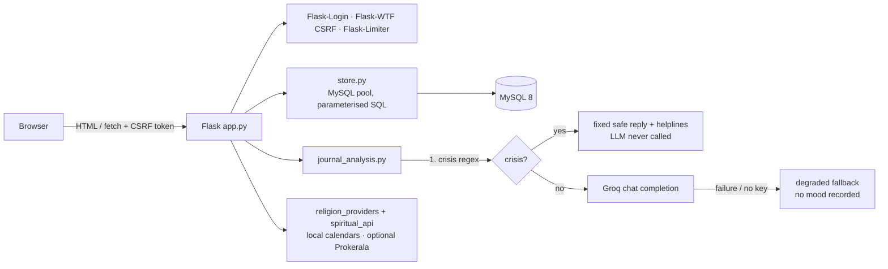

# CONNECT

[](https://github.com/Likhitareddy17/Connect/actions/workflows/ci.yml)

A Flask wellness app with three modules — **spiritual**, **mental** and **emotional** — backed by MySQL, with an
LLM chat companion that is screened by a crisis-safety layer *before* any message reaches the model.

> **Not a medical product.** CONNECT is a reflection and habit tool. It is not therapy and does not diagnose or treat
> anything. See [Safety design](#safety-design) and [Known limitations](#known-limitations).

<!-- Add a screenshot/GIF here: docs/demo.gif -->
<!-- Live demo: https://<your-render-url> -->

## Features

| Module | What it does |
|---|---|
| **Accounts** | Email + password sign-up/login (bcrypt), per-user settings, CSRF-protected forms, rate-limited auth routes |
| **Spiritual** | Religion-aware daily guidance (Hindu, Islam, Christianity, Sikhism, or none): daily practice, upcoming festivals, a clickable calendar, and a persisted jaap (mantra) counter for the Hindu practice |
| **Mental** | Guided breathing reset and grounding practices recommended from your latest mood and daily goal |
| **Emotional** | Multi-turn AI chat with saved threads, a rolling conversation summary, per-thread history, and mood tracking |
| **Dashboard** | 7-day mood breakdown (Chart.js) and profile settings |

## Architecture



**Chat request flow** (`POST /api/chat/message`)

1. Verify the thread in the session belongs to the signed-in user (otherwise start a new one).
2. Save the user message, then load the **latest** 6 messages + the thread's stored summary.
3. `generate_chat_response` screens the newest message for crisis language → returns a fixed response (no LLM call), else calls Groq.
4. Result carries a `source` (`crisis` / `llm` / `fallback`). Only real signals are written to mood analytics; the summary is refreshed every 3rd message.

## Safety design

- **Crisis screening runs first and locally** (regex, `services/journal_analysis.py`). A crisis message never depends on a third-party API being up, and the UI shows a persistent helpline banner.
- Patterns are tested in both directions (`tests/test_journal_analysis.py`): real crisis phrasing is caught, everyday idioms (“it hit me that…”, “this deadline is killing me”) are not.
- The model is prompted never to claim clinical authority or give medical advice, and the UI states that replies come from an AI service (Groq) and are not a substitute for professional care.
- LLM failures degrade to a gentle fixed reply and **do not** fabricate a mood entry.

## Security

CSRF protection on every state-changing route (forms + `X-CSRFToken` on `fetch`) · POST-only logout · open-redirect-safe `next` handling ·
per-thread ownership checks (no cross-user reads, writes or deletes) · LLM output rendered with `textContent`, never `innerHTML` ·
secure/HttpOnly/SameSite cookies · bcrypt with the 72-byte limit enforced · required `FLASK_SECRET_KEY` (fails fast) ·
parameterised SQL everywhere · security headers · rate limiting (Redis-backed when `LIMITER_STORAGE_URI` is set).

## Tech stack

Python 3.11 · Flask 3 · Flask-Login · Flask-WTF · Flask-Limiter · MySQL 8 (`mysql-connector-python` pool) · bcrypt ·
Groq API (`openai/gpt-oss-20b` by default, override with `GROQ_MODEL`) · Chart.js · Gunicorn · Docker · GitHub Actions · Ruff · pytest

## Local setup

```bash
git clone https://github.com/Likhitareddy17/Connect && cd Connect
python -m venv venv && source venv/bin/activate        # Windows: venv\Scripts\activate
pip install -r requirements-dev.txt

cp .env.example .env
# set FLASK_SECRET_KEY (python -c "import secrets; print(secrets.token_hex(32))"),
# MYSQL_PASSWORD, and optionally GROQ_API_KEY

python init_db.py              # creates the schema; safe to re-run — also upgrades older databases
flask --app app run --debug    # http://127.0.0.1:5000
```

Without `GROQ_API_KEY` the app runs and the chat returns a fixed fallback message. Without Prokerala keys the
spiritual module uses its local calendars.

### Docker

```bash
docker build -t connect .
docker run -p 8000:8000 --env-file .env -e COOKIE_SECURE=0 connect   # COOKIE_SECURE=0 only for plain-http localhost
```

Health endpoints: `GET /healthz` (process up) and `GET /readyz` (database reachable).

## Tests

```bash
pytest                                  # 98 unit/route tests, no database or network needed
MYSQL_TEST_HOST=127.0.0.1 MYSQL_TEST_PASSWORD=... pytest     # + 10 integration tests on a real MySQL
ruff check .
```

- Route tests run against an in-memory fake store; integration tests apply `schema.sql` to a throw-away database
  (so a fresh install is verified) and run the full register → chat → crisis → delete flow.
- Regression tests exist for each bug found in review (history window, cross-user thread access, open redirect, …).
- CI (`.github/workflows/ci.yml`) runs lint + all tests against a MySQL 8 service container, then runs `init_db.py` twice.

## Deployment (Render)

`render.yaml` defines the web service (health check `/healthz`, `TRUST_PROXY=1`, generated secret key).
Provision any managed MySQL 8, set the `MYSQL_*` and `GROQ_API_KEY` variables, run `python init_db.py` once against it,
and set `LIMITER_STORAGE_URI` to a Redis URL so rate limits are shared across Gunicorn workers.

## Project layout

```
app.py                  routes, auth, CSRF, security headers, health checks
store.py                MySQL data layer (pooled, parameterised)
schema.sql / init_db.py schema + idempotent upgrade script
services/
  journal_analysis.py   crisis screen, Groq call, rolling summary, ChatResult
  grounding.py          mood → practice recommendation
  religion_providers.py per-religion calendars (festivals, Easter computation, …)
  spiritual_api.py      daily panchang (local data, optional Prokerala)
templates/ static/      Jinja templates, CSS, vanilla JS
tests/                  unit, route and MySQL integration tests
```

## Known limitations

Being explicit about these is deliberate:

- **Crisis detection is a regex baseline**, not a clinical classifier. It will miss indirect or non-English phrasing. A second-layer model-based check is the next step.
- **Helpline numbers are hardcoded** (India); verify them before any real deployment.
- **Festival data is curated for 2026** and Islamic/Sikh dates are approximate; later years need a data update or a proper calendar library.
- **Live Panchang** needs a paid Prokerala plan for arbitrary dates; on the free plan it is used only on Jan 1st (otherwise local data is shown).
- Chat messages are stored in plaintext and sent to a third-party LLM provider. There is no account/data deletion flow, email verification or password reset yet.
- No Content-Security-Policy yet (templates use inline scripts).

## Roadmap

Account + data deletion · email verification & password reset · app factory (`create_app`) · Alembic migrations ·
model-based safety classifier · CSP with nonces · per-year calendar data/library · E2E browser tests.
