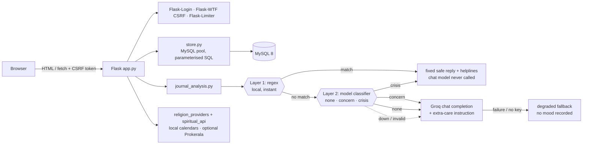

# CONNECT

[](https://github.com/Likhitareddy17/Connect/actions/workflows/ci.yml)

A Flask wellness app with three modules — **spiritual**, **mental** and **emotional** — backed by MySQL, with an
LLM chat companion that is screened by a crisis-safety layer *before* any message reaches the model.

> **Not a medical product.** CONNECT is a reflection and habit tool. It is not therapy and does not diagnose or treat
> anything. See [Safety design](#safety-design) and [Known limitations](#known-limitations).

<!-- Add a screenshot/GIF here: docs/demo.gif -->
<!-- Live demo: https://<your-render-url> -->

## Features

| Module | What it does |
|---|---|
| **Accounts** | Email + password sign-up/login (bcrypt), per-user settings, CSRF-protected forms, rate-limited auth routes |
| **Spiritual** | Religion-aware daily guidance (Hindu, Islam, Christianity, Sikhism, or none): daily practice, upcoming festivals, a clickable calendar, and a persisted jaap (mantra) counter for the Hindu practice |
| **Mental** | Guided breathing reset and grounding practices recommended from your latest mood and daily goal |
| **Emotional** | Multi-turn AI chat with saved threads, a rolling conversation summary, per-thread history, and mood tracking |
| **Dashboard** | 7-day mood breakdown (Chart.js) and profile settings |

## Architecture



**Chat request flow** (`POST /api/chat/message`)

1. Verify the thread in the session belongs to the signed-in user (otherwise start a new one).
2. Save the user message, then load the **latest** 6 messages + the thread's stored summary.
3. `generate_chat_response` screens the newest message for crisis language → returns a fixed response (no LLM call), else calls Groq.
4. Result carries a `source` (`crisis` / `llm` / `fallback`). Only real signals are written to mood analytics; the summary is refreshed every 3rd message.

## Safety design

Every message passes two independent layers before the chat model sees it (`services/safety.py`):

| Layer | Strength | Weakness |
|---|---|---|
| **1. Regex** | instant, local, deterministic, works offline | blind to paraphrase and non-English wording; the bare word "suicide" is a false alarm for film titles or essays |
| **2. Model classifier** | catches indirect, euphemistic and Hindi-romanised distress | adds one API call (latency, rate limit), is itself an LLM, can be wrong or manipulated |

The layers produce a **graded** verdict rather than a vote:

- **crisis** → fixed safe reply with helplines; the chat model is never called; the UI shows a helpline banner.
- **concern** → normal reply, but the chat model is told to respond with extra care; the UI shows a gentle "support is available" note.
- **none** → normal reply.

Design decisions, with the trade-offs:

- Regex runs first, so an explicit crisis never waits on (or depends on) the network. Either layer can raise the level; neither can lower the other's verdict.
- **Fail-soft:** if the classifier times out or returns junk, chat continues on the regex layer and the event is logged as `unavailable`.
- A "crisis" verdict below `SAFETY_CRISIS_THRESHOLD` (default 0.6) confidence is downgraded to "concern", not ignored.
- User text is untrusted: sent in the *user* role inside delimiters (a user-typed `</conversation>` is stripped) and the model's output is validated against a strict schema. This reduces prompt-injection risk but cannot remove it, which is why layer 1 stays independent of the model.
- Message text is never logged; only level, category and which layer decided.
- Everything else: the model is prompted never to claim clinical authority, and the UI states that replies come from an AI service (Groq) and are not a substitute for professional care. LLM failures degrade to a gentle fixed reply and never fabricate a mood entry.

**Measuring it:** `python scripts/eval_safety.py [--model]` scores each layer on a small hand-written labelled set
(`scripts/safety_cases.json`). Regex alone catches 6/6 explicit crisis messages but 0/19 paraphrased ones, and raises 2 false alarms
on 13 benign sentences. The set is synthetic and deliberately probes regex's blind spot: it shows *what kind* of message each layer
misses, not a real-world miss rate. Run it with `--model` and your own key to see layer 2's numbers; they are not published here
because they have not been measured against a validated dataset.

## Security

CSRF protection on every state-changing route (forms + `X-CSRFToken` on `fetch`) · POST-only logout · open-redirect-safe `next` handling ·
per-thread ownership checks (no cross-user reads, writes or deletes) · LLM output rendered with `textContent`, never `innerHTML` ·
secure/HttpOnly/SameSite cookies · bcrypt with the 72-byte limit enforced · required `FLASK_SECRET_KEY` (fails fast) ·
parameterised SQL everywhere · security headers · rate limiting (Redis-backed when `LIMITER_STORAGE_URI` is set).

## Tech stack

Python 3.9+ (CI tests 3.9 and 3.12; Docker image uses 3.11) · Flask 3 · Flask-Login · Flask-WTF · Flask-Limiter · MySQL 8 (`mysql-connector-python` pool) · bcrypt ·
Groq API (`openai/gpt-oss-20b` by default, override with `GROQ_MODEL`) · Chart.js · Gunicorn · Docker · GitHub Actions · Ruff · pytest

## Local setup

```bash
git clone https://github.com/Likhitareddy17/Connect && cd Connect
python -m venv venv && source venv/bin/activate        # Windows: venv\Scripts\activate
pip install -r requirements-dev.txt

cp .env.example .env
# set FLASK_SECRET_KEY (python -c "import secrets; print(secrets.token_hex(32))"),
# MYSQL_PASSWORD, and optionally GROQ_API_KEY

python init_db.py              # creates the schema; safe to re-run — also upgrades older databases
flask --app app run --debug    # http://127.0.0.1:5000
```

Without `GROQ_API_KEY` the app runs and the chat returns a fixed fallback message. Without Prokerala keys the
spiritual module uses its local calendars.

### Docker

```bash
docker build -t connect .
docker run -p 8000:8000 --env-file .env -e COOKIE_SECURE=0 connect   # COOKIE_SECURE=0 only for plain-http localhost
```

Health endpoints: `GET /healthz` (process up) and `GET /readyz` (database reachable).

## Tests

```bash
pytest                                  # 196 unit/route tests, no database or network needed
MYSQL_TEST_HOST=127.0.0.1 MYSQL_TEST_PASSWORD=... pytest     # + 12 integration tests on a real MySQL
ruff check .
```

- Route tests run against an in-memory fake store; integration tests apply `schema.sql` to a throw-away database
  (so a fresh install is verified) and run the full register → chat → crisis → delete flow.
- Regression tests exist for each bug found in review (history window, cross-user thread access, open redirect, …).
- CI (`.github/workflows/ci.yml`) runs lint + all tests against a MySQL 8 service container, then runs `init_db.py` twice.

## Deployment (Render + managed MySQL)

Render hosts the web service; the database must be a MySQL 8 instance from any provider (Render's own managed
databases are PostgreSQL). Check the provider's current free-tier limits (idle shutdown, expiry, connection caps).

1. **Create the MySQL database** and note host, port, user, password and database name.
2. **Create the schema once from your machine** (the database may already exist and your user may be unable to create
   databases; `init_db.py` handles both, and it can also upgrade older databases):
   ```bash
   MYSQL_HOST=... MYSQL_PORT=... MYSQL_USER=... MYSQL_PASSWORD=... MYSQL_DATABASE=<the db your provider gave you> python init_db.py
   ```
3. **TLS.** Most managed hosts require it. The driver negotiates TLS by default; for verified TLS commit the provider's
   (public) CA certificate, e.g. as `certs/ca.pem`, and set `MYSQL_SSL_CA=certs/ca.pem` and `MYSQL_SSL_VERIFY=1`.
4. **Create a Render Blueprint** from this repo (it reads `render.yaml`: health check `/healthz`, `TRUST_PROXY=1`, generated
   `FLASK_SECRET_KEY`). Set `MYSQL_*` and `GROQ_API_KEY` in the dashboard, never in the repo. Optionally set
   `LIMITER_STORAGE_URI` to a Redis URL so rate limits are shared across Gunicorn workers.
5. **Verify:** `/healthz` (process up) and `/readyz` (database reachable), then register, chat, and try a crisis phrase.

## Project layout

```
app.py                  routes, auth, CSRF, security headers, health checks
store.py                MySQL data layer (pooled, parameterised)
schema.sql / init_db.py tables + idempotent create/upgrade script (works on managed hosts)
services/
  journal_analysis.py   crisis screen, Groq call, rolling summary, ChatResult
  grounding.py          mood → practice recommendation
  religion_providers.py per-religion calendars (festivals, Easter computation, …)
  spiritual_api.py      daily panchang (local data, optional Prokerala)
templates/ static/      Jinja templates, CSS, vanilla JS
tests/                  unit, route and MySQL integration tests
```

## Known limitations

Being explicit about these is deliberate:

- **The safety layers are aids, not a clinical tool.** The classifier has not been validated on real data; a regex hit is final (so "Suicide Squad" triggers the crisis reply); prompt injection can be reduced but not eliminated; and the chat model's *reply* is not screened yet (output moderation is the next step).
- **The classifier doubles the API calls per message** (latency and Groq rate limits). Set `SAFETY_CLASSIFIER_ENABLED=0` to disable it, or `GROQ_SAFETY_MODEL` to use a smaller, faster model for it.
- **Helpline numbers are hardcoded** (India); verify them before any real deployment.
- **Festival data is curated for 2026** and Islamic/Sikh dates are approximate; later years need a data update or a proper calendar library.
- **Live Panchang** needs a paid Prokerala plan for arbitrary dates; on the free plan it is used only on Jan 1st (otherwise local data is shown).
- Chat messages are stored in plaintext and sent to a third-party LLM provider. There is no account/data deletion flow, email verification or password reset yet.
- No Content-Security-Policy yet (templates use inline scripts).

## Roadmap

Account + data deletion · email verification & password reset · app factory (`create_app`) · Alembic migrations ·
output moderation + a validated safety eval set · CSP with nonces · per-year calendar data/library · E2E browser tests.
